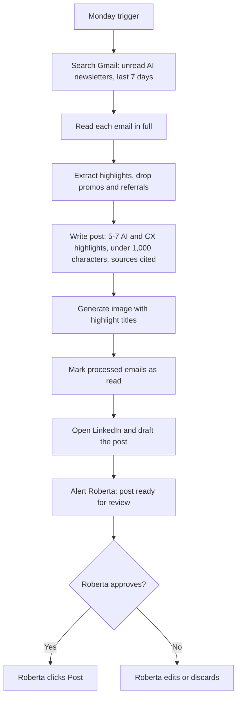

# Roberta's AI Agent: Weekly AI Digest for LinkedIn

An AI agent that reads my AI newsletters every week, picks the highlights that matter for CX and no-code, and drafts a LinkedIn post for me to approve.

## The problem

I subscribe to more than ten AI newsletters. Reading all of them every week takes hours, and the useful insights get buried under promotions and referral sections. I also wanted to share what I learn with my network on a regular cadence, without spending my week writing about it.

## The solution

A scheduled agent that runs every Monday, does the reading and the first draft, and stops right before publishing. I stay in control: nothing goes live until I click Post.

## How it works

## Key design decisions

- **Human in the loop.** The agent drafts, I publish. It never posts on its own.
- **A clear persona.** The agent writes as "Roberta's AI Agent", in the third person, with a dry, self-aware robotic humor. Every post ends with "Roberta approved this post. ✅" so readers know exactly who wrote what.
- **Source transparency.** Every highlight cites the newsletter or website it came from.
- **A CX angle.** Each post closes with insights that connect the week's news to CX and no-code, plus a question to drive engagement.
- **Inbox hygiene.** Processed emails are marked as read, so the next run starts clean and nothing is summarized twice.
- **Strict constraints.** 5 to 7 highlights, 2 to 3 sentences each, under 1,000 characters, always in English.

## Sources it reads

Tech Drops, AlphaSignal, The Deep View, Superhuman AI, DataNorth, TLDR, MarkTechPost, Turing Post, The Neuron, Sloth Bytes, Futurism, and any other AI newsletter in the inbox.

## Stack

Claude (agent and scheduled task) · Gmail · LinkedIn via browser automation · AI image generation

## Example output

See a real post generated by the agent: [Weekly AI digest on LinkedIn](https://www.linkedin.com/feed/update/urn:li:activity:7528478985681428481/)

<!-- Add a screenshot of the post here:  -->

## What I learned

<!-- Add 2-3 lines in your own words -->
